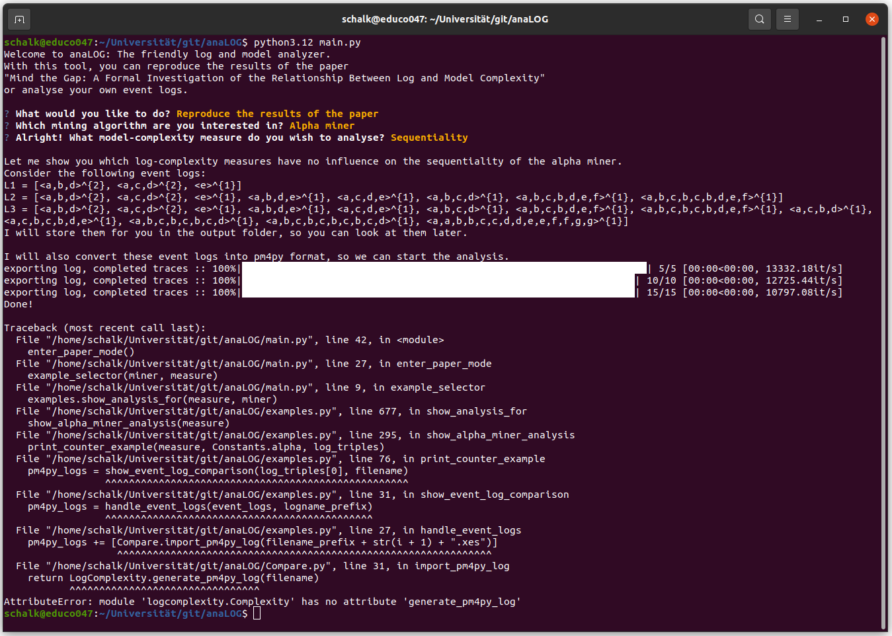
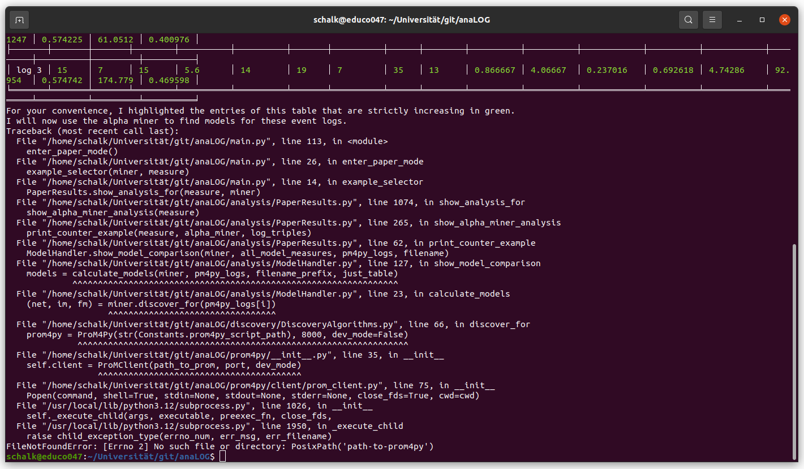
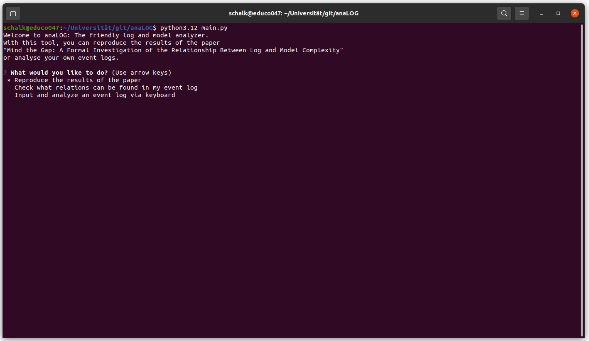
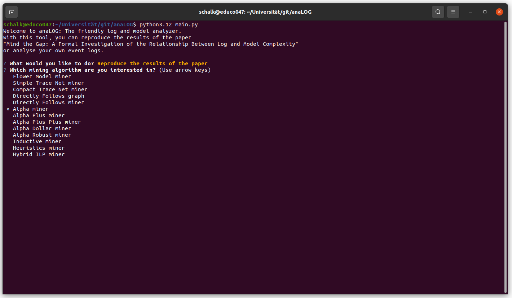
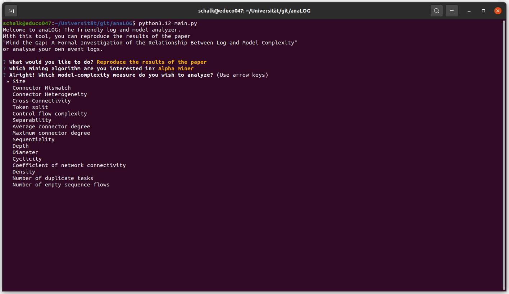
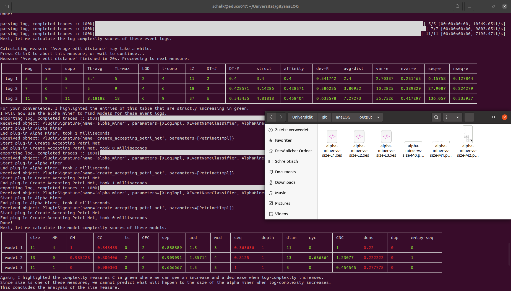
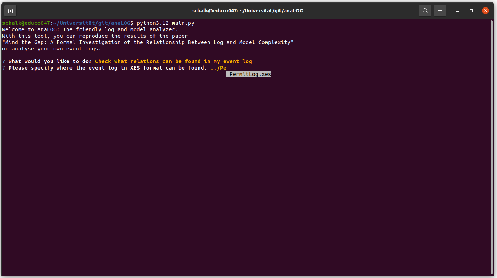
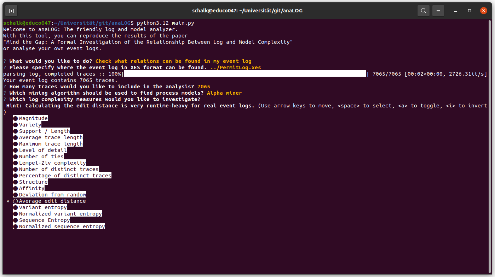
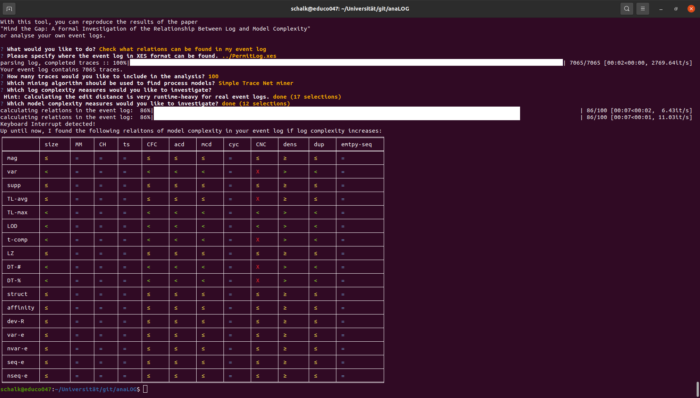
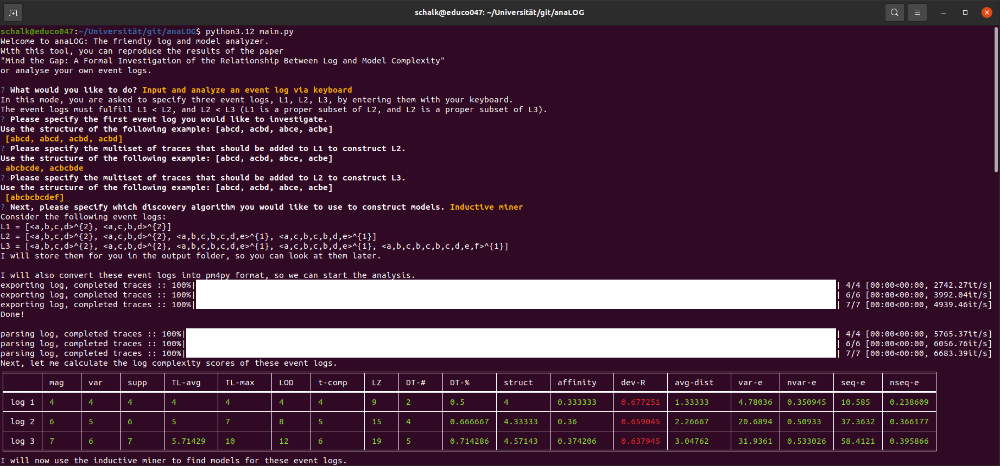

# anaLOG: The friendly log and model analyzer #
This project accompanies the paper *Mind the Gap: A Formal Investigation of the Relationship Between Log and Model Complexity*, available at (https://doi.org/10.48550/arXiv.2505.23233).
With this tool, you can reproduce the results of the paper.
Furthermore, you can use this tool to analyze the relations between log and model complexity in real-life event logs.


## Installation ##
1. Ensure that you have *Python 3.12* or later installed.
2. Clone the project to your local files.
3. Go to (https://github.com/MaxVidgof/process-complexity) and download the file *Complexity.py* from this repository.
4. Replace ./logcomplexity/Complexity.py by the file *Complexity.py* you just downloaded.
5. Go to (https://zenodo.org/records/13853660), download and install *ProM4Py* on your system wherever you like.
6. Copy the contents of the folder `ProM4Py-Python-Library/prom4py` into the `./prom4py` folder of the anaLOG-tool, but keep the files `discovery.py` and `__init__.py` provided by anaLOG, as these files enable ProM4Py to call more discovery algorithms than the Inductive Miner.
7. Replace the string for the variable `prom4py_script_path` in the file `Constants.py` by the path where you installed ProM4Py and where the file `ProM4Py.sh` or `ProM4Py.bat` is located. Choose the path to `ProM4Py.bat` if you work on a Windows system, or `Prom4Py.sh` if you work on a Unix system.
8. Install the requirements listed in *requirements.txt*, for example by opening a terminal and executing:
```
python3.12 -m pip install -r requirements.txt
```
9. Run the program by executing
```
python3.12 main.py
```

### Trouble-Shooting ###
- If you get the following error, you did not replace `./logcomplexity/Complexity.py` by *Complexity.py* from (https://github.com/MaxVidgof/process-complexity).


- If you get the following error, you forgot to replace the string `'path-to-prom4py/Prom4Py.sh'` by the path where the `.sh` or `.bat` file are located.



## Usage ##
Run the program by executing the following command:
```
python3.12 main.py
```
If the installation was successful, you will be greeted by the following sight:

You can use the arrow keys to navigate through the options and hit enter to choose.
With the first option, you can reproduce the results found in the paper (see __Paper Mode__).
The second option enables you to analyze which relations between log and model complexity can be found in some .xes file stored on your system (see __Real Log Mode__).
With the third option, you can input event logs via keyboard and analyze the relations beween log and model complexity induced by these logs (see __Playground Mode__).

### Paper Mode ###
Upon choosing this option, anaLOG will prompt you to specify the discovery algorithm you want to analyze.

Currently, anaLOG allows the following options:
- Flower Model miner -- produces a flower model for the event log, as implemented in ProM
- Simple Trace Net miner -- produces a workflow net where each trace becomes a unique path from the initial to the final place
- Compact Trace Net miner -- produces a workflow net like the simple trace net, but where common states are merged, as implemented in ProM
- Directly Follows Graph -- produces the directly follows graph for the event log
- Directly Follows miner -- constructs the directly follows model as detailed in the following paper: (https://doi.org/10.1109/ICPM.2019.00015)
- Alpha miner -- executes the alpha algorithm as detailed in (https://doi.org/10.1109/TKDE.2004.47) and implemented in ProM
- Alpha Plus miner -- executes the alpha plus miner as detailed in (https://doi.org/10.1007/978-3-540-30188-2_12) and implemented in ProM
- Alpha Plus Plus miner -- executes the alpha plus plus miner as detailed in (https://doi.org/10.1007/s10618-007-0065-y) and implemented in ProM
- Alpha Dollar miner -- executes the alpha dollar miner as detailed in (https://doi.org/10.1007/978-3-319-23063-4_7) and implemented in ProM
- Alpha Robust miner -- executes the alpha robust miner as implemented in ProM
- Inductive miner -- executes the inductive miner as detailed in (https://doi.org/10.1007/978-3-319-06257-0_6) and implemented in ProM
- Heuristics miner -- executes the heuristics miner as detailed in (https://research.tue.nl/en/publications/process-mining-with-the-heuristicsminer-algorithm/) and implemented in ProM
- Hybrid ILP miner -- executes the hybrid ILP miner as detailed in (https://doi.org/10.1007/978-3-319-23063-4_10) and implemented in ProM
With two exceptions, this list includes are all discovery algorithms that are callable via command line interface with ProM 6.14.
The two exceptions being:
- Alpha Sharp miner: This discovery algorithm is very unstable and produces NullPointerExceptions very quickly, which is why we excluded it from our analysis.
- Decomposition Miner: The implementation of this discovery algorithm requires permanent access to other modules of ProM. Since we settled on using ProM4Py to call the discovery algorithms, and ProM4Py only loads certain ProM modules, this algorithm cannot be executed.

After you chose a discovery algorithm, anaLOG will ask you which model complexity measure you would like to investigate.
It will not ask for a log complexity measure, since it will automatically show the analyses for *all* log complexity measures.


After your choice, the program will guide you through the corresponding results of the paper.

During its execution, the program will store the event logs and the models in the output folder for later reference.

### Real Log Mode ###
By choosing this option, you can specify an event log in .xes format that is somewhere on your file system.
anaLOG will ask you to specify the relative path to the event log.

After anaLOG has imported the event log, you may specify how many of the traces you wish to analyze.
AnaLOG will take each prefix of the event log up to the specified size and check which relations between log and model complexity could be found in the real life event log.
To customize your analyses, you can choose which log and model complexity measures you want to investigate.

We advise to disable the log complexity measure *Average Edit Distance*, as well as the model complexity measures *Cross-Connectivity*, *Separability*, *Sequentiality*, *Diameter* and *Depth*, as these take a lot of time to compute for realistic event logs.
You will see that, with increasing amount of traces, the discovery phase takes longer. 
For your convenience, anaLOG offers the option to cancel the calculation at any time by pressing CTRL+C.
The tool will then show all relations that it found up to the point of cancellation in a table that resembles those of our paper.


### Playground Mode ###
In playground mode, you can specify three event logs via keyboard.
The string you input will be interpreted as an event log, where traces are divided by commas and each symbol corresponds to an activity.
For example, the inputs `[abcd, abcd, acbd, acbd]`, `[abcbcde, acbcbde]`, `[abcbcbcdef]` will result in the event logs:
- L1 = `[<a,b,c,d>^2, <a,c,b,d>^2]`
- L2 = `[<a,b,c,d>^2, <a,c,b,d>^2, <a,b,c,b,c,d,e>, <a,c,b,c,b,d,e>]`
- L3 = `[<a,b,c,b,c,b,c,d,e,f>]`
This means, you can only specify event logs that are subsets of each other.
During the input, you can omit the surrounding square brackets of your event log.


